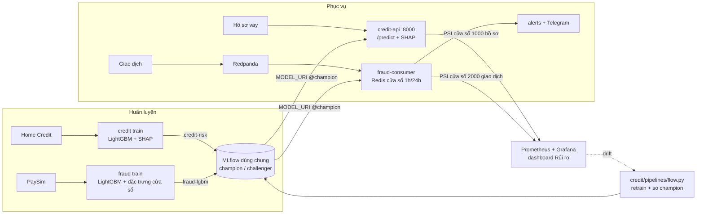

# Nền tảng ML rủi ro: chấm điểm tín dụng và phát hiện gian lận thời gian thực

[](../../actions/workflows/ci.yml)

Hai mô hình rủi ro của một ngân hàng chạy trên **một nền tảng vận hành chung**:

- **Tín dụng** (theo lô và theo yêu cầu): chấm xác suất vỡ nợ của hồ sơ vay, ngưỡng theo chi phí, 3 lý do SHAP cho mỗi
  quyết định; giám sát drift và retrain tự động; triển khai Kubernetes (Helm, HPA, canary).
- **Gian lận** (trên luồng): chấm từng giao dịch trong vài mili giây từ Kafka, đặc trưng cửa sổ thời gian trong Redis,
  một hàm đặc trưng duy nhất cho train và phục vụ (đã kiểm tra không lệch).

Phần dùng chung: **một MLflow** (registry, alias champion/challenger, dịch vụ nạp mô hình thẳng từ registry), **một
cách đo drift** (PSI trên cửa sổ trượt, cùng tên số đo), **một Prometheus + Grafana**.

| Thư mục | Vai trò | Dự án gốc |
|---|---|---|
| [`credit/`](credit/) | LightGBM + Optuna, SHAP, FastAPI; PSI/Evidently + Prefect retrain; Helm, kind, HPA, canary, k6 | #2, #25, #26 |
| [`fraud/`](fraud/) | Redpanda (Kafka), Redis, LightGBM, cảnh báo Telegram, kiểm tra lệch đặc trưng offline/online | #24 |
| [`riskops/`](riskops/) | Thư viện dùng chung: PSI/KS, `StreamDrift`, gauge Prometheus, MLflow registry | mới, khi gộp |

## Kiến trúc



Ba chỗ nối, mỗi chỗ có code và test thật:

1. **Một MLflow cho hai mô hình.** `riskops/src/riskops/registry.py` ghi lần train, tạo phiên bản, gắn alias, tải
   mô hình về. Tín dụng (`credit/src/credit_risk/train.py`) và gian lận (`fraud/src/fraudrt/train.py --mlflow`) cùng
   dùng; `fraud/src/fraudrt/promote.py` chỉ đưa challenger lên champion khi PR-AUC trên cùng tập test mới tăng ít nhất
   0.005 (cùng quy tắc với tín dụng). Đặt `MODEL_URI=models:/<tên>@champion` là API và consumer nạp thẳng từ registry:
   đổi mô hình là đổi alias, không build lại image.
2. **Drift trên luồng cho cả hai.** `riskops.drift.StreamDrift` tính PSI từng đặc trưng và của điểm số trên cửa sổ
   trượt so với mẫu train (lưu cùng mô hình), mỗi vài trăm sự kiện một lần để không làm chậm việc chấm. API tín dụng
   và consumer gian lận đẩy kết quả lên cùng số đo `risk_feature_psi{model=...}`, `risk_score_psi`, `risk_drift_alert`.
   Kiểm tra theo lô hằng tháng (`credit/pipelines/monitor.py`, Evidently) dùng cùng hàm PSI.
3. **Một chỗ giám sát.** Prometheus thu `/metrics` của cả hai; dashboard `monitoring/grafana/dashboards/risk.json`
   gồm drift của hai mô hình, lưu lượng và độ trễ từng dịch vụ (dashboard chi tiết luồng gian lận vẫn giữ).

`tests/test_platform.py` chạy cả chuỗi offline: train hai mô hình vào một MLflow, duyệt champion, hai dịch vụ nạp
champion từ registry, một tháng hồ sơ lệch phân phối làm `risk_drift_alert{model="credit"}` bật còn luồng giao dịch
bình thường thì không.

## Kết quả

> Điền sau khi chạy trên dữ liệu thật. Không dùng số trên dữ liệu giả lập. Bảng đầy đủ nằm trong README từng thư mục.

| Phần | Chỉ số | Giá trị | Lấy từ |
|---|---|---|---|
| Tín dụng (Home Credit, 307 nghìn hồ sơ) | ROC-AUC LightGBM / baseline logistic | X / X | `credit/reports/metrics.md` |
| Tín dụng | Giảm chi phí khi chọn ngưỡng theo chi phí so với 0.5 | X% | `credit/reports/metrics.md` |
| Tín dụng | p95 API với k6, 50 người dùng ảo (máy: X) | X ms | `credit/deploy/k6/load.js` |
| Tín dụng | Giả lập 12 tháng: AUC trung bình để nguyên / có retrain | X / X | `credit/reports/sim/simulation.md` |
| Gian lận (PaySim, 6,3 triệu giao dịch) | PR-AUC có / không đặc trưng cửa sổ; đoán ngẫu nhiên | X / X; X | `fraud/reports/train.md` |
| Gian lận | Sự kiện/giây; p95, p99 trên luồng (máy: X) | X; X ms, X ms | `fraud/reports/stream.md` |
| Gian lận | Lệch đặc trưng offline/online | X | `fraud/reports/stream.md` |

## Chạy

Cần Python 3.10+, Docker (Compose v2). Test không cần Docker.

Không cần cài gì trên máy: mở repo bằng **GitHub Codespaces** (Code > Codespaces > Create codespace). Cấu hình trong
[`.devcontainer/`](.devcontainer/) dựng sẵn Python 3.11, Docker, Node 20 và chạy `make install`; mở giao diện qua tab
Ports. Cụm kind cho Kubernetes: chạy `bash .devcontainer/k8s-tools.sh` cài kind, kubectl, Helm, k6.

### Thử nhanh bằng dữ liệu giả lập (laptop, CPU)

```bash
make install && make test       # test 3 phần + test xuyên suốt, khoảng 1 phút
make train-synthetic            # credit/models, fraud/models
make up                         # MLflow, API tín dụng, Redpanda, Redis, consumer, Prometheus, Grafana
make smoke                      # gửi 600 hồ sơ + 3000 giao dịch, kiểm tra số đo và dashboard
make produce                    # phát giao dịch liên tục (PaySim nếu đã tải), xem http://localhost:3000
```

- http://localhost:8000/docs: API tín dụng
- http://localhost:5000: MLflow (cả `credit-risk` và `fraud-lgbm`)
- http://localhost:3000: Grafana, dashboard "Rủi ro: tín dụng + gian lận"

### Đăng ký vào MLflow và nạp champion từ registry

```bash
make register ARGS=--synthetic   # bỏ ARGS khi đã có dữ liệu thật trong credit/data và fraud/data
CREDIT_MODEL_URI=models:/credit-risk@champion FRAUD_MODEL_URI=models:/fraud-lgbm@champion docker compose up -d
make smoke
```

### Dữ liệu thật

- Tín dụng: `cd credit && make data && make train` (Home Credit, cần `kaggle.json`; chạy được trên Colab CPU:
  `credit/notebooks/01_train_colab.ipynb`).
- Gian lận: `cd fraud && make data && make train`, rồi `make up bench` để đo độ trễ và lệch đặc trưng
  (`fraud/notebooks/fraud_colab.ipynb` cho máy không có Docker).
- Drift theo lô và retrain: `cd credit && make monitor simulate`.
- Kubernetes: `cd credit && bash deploy/scripts/kind-up.sh`.

## Notebook Colab

Bấm link để mở trên Colab (Runtime > Run all). Notebook tự dùng dữ liệu thật khi đã có trên Drive và
khóa trong Colab Secrets, không thì chạy dữ liệu giả lập và không đẩy gì; ô cuối đẩy báo cáo lên GitHub.

| Notebook | Làm gì | Máy |
|---|---|---|
| [credit/notebooks/01_train_colab.ipynb](https://colab.research.google.com/github/tak2k5/risk-ml-platform/blob/main/credit/notebooks/01_train_colab.ipynb) | Tín dụng trên Home Credit, SHAP, mô phỏng drift (#2, #25) | CPU |
| [fraud/notebooks/fraud_colab.ipynb](https://colab.research.google.com/github/tak2k5/risk-ml-platform/blob/main/fraud/notebooks/fraud_colab.ipynb) | Gian lận: train và phát lại luồng không cần Docker (#24) | CPU |

## CI

`.github/workflows/ci.yml`: lint và test cả repo; dựng cả nền tảng bằng docker compose, gửi lưu lượng, đăng ký vào
MLflow rồi khởi động lại để nạp champion từ registry; luồng gian lận đo độ trễ và lệch đặc trưng; cụm kind cài Helm
chart tín dụng. `monitor.yml`: giả lập 12 tháng drift + retrain mỗi tuần.

## Giới hạn

- Dữ liệu trong CI và `make train-synthetic` là **giả lập**; số trên đó chỉ chứng minh đường ống chạy đúng.
- PSI trên cửa sổ trượt bỏ `hour_of_day` (đổi theo chu kỳ ngày, cửa sổ vài giờ luôn lệch). Đặc trưng cửa sổ của gian
  lận chỉ đúng khi Redis có đủ 24 giờ lịch sử, nên ngay sau khi xóa Redis drift sẽ báo lệch: đó là cảnh báo đúng.
- Mỗi container API chạy 1 worker để số đo Prometheus không bị chia giữa các tiến trình; chịu tải bằng nhiều replica.
- Nhãn gian lận và vỡ nợ đến muộn ngoài thực tế, nên PSI (không cần nhãn) là tín hiệu sớm; quyết định thay mô hình vẫn
  phải dựa trên dữ liệu có nhãn.
- Home Credit và PaySim theo điều khoản Kaggle, không đưa vào repo. PaySim là dữ liệu mô phỏng.

## Dòng CV gợi ý

> **Nền tảng ML rủi ro** (LightGBM, SHAP, FastAPI, Kafka, Redis, MLflow, Prometheus, Kubernetes): chấm điểm tín dụng
> trên 307 nghìn hồ sơ Home Credit, ROC-AUC X, ngưỡng theo chi phí giảm X% chi phí; phát hiện gian lận trên luồng
> PaySim, PR-AUC X (đặc trưng cửa sổ thời gian thêm X), p95 X ms ở X giao dịch/giây, không lệch đặc trưng giữa train và
> phục vụ. Hai mô hình dùng chung MLflow registry (champion/challenger), giám sát drift PSI trên luồng và Grafana;
> retrain tự động bằng Prefect; triển khai Helm với HPA và canary.

Thay mọi X bằng số thật; vế nào chưa đo thì bỏ.

## Giấy phép

MIT. Dữ liệu theo điều khoản Kaggle của từng bộ, không phát tán lại.
