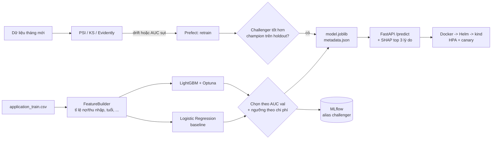

# Chấm điểm rủi ro tín dụng: từ mô hình đến vận hành

[](https://colab.research.google.com/github/tak2k5/risk-ml-platform/blob/main/credit/notebooks/01_train_colab.ipynb)

> Thư mục này là một phần của repo `risk-ml-platform` (xem [README gốc](../README.md)): dùng chung MLflow, Prometheus,
> Grafana và thư viện `riskops` (đo drift, registry) với mô hình gian lận trong `fraud/`. Lệnh dưới đây chạy từ
> thư mục `credit/`.

Dự đoán xác suất một khách hàng **không trả được nợ**, giải thích lý do cho từng hồ sơ, phục vụ qua API,
tự phát hiện khi dữ liệu thay đổi để huấn luyện lại, và triển khai trên Kubernetes.

Repo gộp ba dự án trong lộ trình: **#2** (mô hình + API), **#25** (giám sát drift + retrain), **#26** (Kubernetes).

---

## 1. Bài toán

Ngân hàng nhận hồ sơ vay và phải quyết định **duyệt** hay **từ chối**. Hai loại sai có chi phí khác nhau:

| Sai lầm | Ý nghĩa | Chi phí giả định |
| --- | --- | --- |
| Cho vay người sẽ vỡ nợ (FN) | mất tiền gốc | 10 |
| Từ chối nhầm người tốt (FP) | mất tiền lãi | 1 |

Vì vậy ngưỡng quyết định **không phải 0.5**, mà được chọn để tổng chi phí nhỏ nhất (trên tập validation).
Mỗi quyết định kèm **3 lý do** (SHAP) để nhân viên tín dụng giải thích được với khách.

## 2. Dữ liệu

[Home Credit Default Risk](https://www.kaggle.com/competitions/home-credit-default-risk) (Kaggle), file
`application_train.csv`: khoảng 307 nghìn hồ sơ, khoảng 8% vỡ nợ. Dữ liệu **không** nằm trong repo
(điều khoản cuộc thi), xem [data/README.md](data/README.md) để tải.

Không có dữ liệu thật vẫn chạy được mọi thứ bằng `--synthetic`: bộ sinh dữ liệu giả lập cùng tên cột,
phân phối gần giống. CI và test dùng dữ liệu giả lập.

Cột `CODE_GENDER` bị loại có chủ đích: mô hình không được dùng giới tính để quyết định cho vay.

## 3. Kiến trúc



Điểm thiết kế chính:

- **Một pipeline scikit-learn duy nhất** (tạo đặc trưng → tiền xử lý → mô hình) được lưu thành một file,
  nên lúc train và lúc phục vụ dùng chung code, tránh lệch giữa hai môi trường (training-serving skew).
- **Test chỉ dùng một lần** ở cuối. Mọi lựa chọn (mô hình, tham số, ngưỡng) đều làm trên validation.
- **Champion / challenger**: mô hình mới chỉ thay mô hình cũ khi tốt hơn ít nhất 0.005 AUC trên cùng một
  tập holdout mới, tránh thay qua thay lại vì nhiễu.

```
src/credit_risk/     config, data, features, pipeline, evaluate, explain, train, schemas, api
pipelines/           (#25) drift.py, monitor.py, promote.py, flow.py (Prefect), simulate.py
deploy/              (#26) helm/, kind/, k6/, scripts/kind-up.sh, scripts/canary.sh
notebooks/           01_train_colab.ipynb: chạy toàn bộ trên Colab CPU
tests/               24 test, chạy bằng dữ liệu giả lập
```

## 4. Kết quả

> Điền sau khi chạy trên **dữ liệu thật** (`make train`), chép từ `reports/metrics.md`.
> Không điền số từ dữ liệu giả lập.

| Mô hình | ROC-AUC | PR-AUC | KS | Brier |
| --- | --- | --- | --- | --- |
| Logistic Regression (baseline) | X | X | X | X |
| LightGBM (Optuna 30 lần thử) | X | X | X | X |

- Ngưỡng theo chi phí: X, duyệt X% hồ sơ, chặn được X% người vỡ nợ.
- API: độ trễ p95 X ms với k6, 50 người dùng ảo (`deploy/k6/load.js`, ghi rõ cấu hình máy).
- Giả lập 12 tháng (#25, dữ liệu giả lập): AUC trung bình để nguyên X, tự retrain X
  (`reports/sim/simulation.md`, `reports/sim/simulation.png`).

## 5. Cách chạy

### Trên Colab (khuyến nghị để huấn luyện)

Bấm nút **Open in Colab** ở đầu trang, chạy lần lượt các ô. Chỉ cần CPU.

### Trên máy cá nhân

```bash
python -m venv .venv && source .venv/bin/activate
pip install -r requirements-dev.txt
export PYTHONPATH=src:../riskops/src   # riskops: thư viện dùng chung ở ../riskops

make train-synthetic        # hoặc: make data && make train   (dữ liệu thật)
make test                   # 24 test
make api                    # mở http://localhost:8000/docs
```

Gọi API:

```bash
curl -X POST localhost:8000/predict -H 'Content-Type: application/json' \
  -d @- <<'JSON'
{"CNT_CHILDREN":1,"AMT_INCOME_TOTAL":180000,"AMT_CREDIT":600000,"AMT_ANNUITY":28000,
 "AMT_GOODS_PRICE":540000,"DAYS_BIRTH":-12000,"DAYS_EMPLOYED":-2500,"DAYS_ID_PUBLISH":-3000,
 "EXT_SOURCE_1":null,"EXT_SOURCE_2":0.55,"EXT_SOURCE_3":0.48,"REGION_RATING_CLIENT":2,
 "NAME_CONTRACT_TYPE":"Cash loans","FLAG_OWN_CAR":"N","FLAG_OWN_REALTY":"Y",
 "NAME_INCOME_TYPE":"Working","NAME_EDUCATION_TYPE":"Secondary / secondary special",
 "NAME_FAMILY_STATUS":"Married","NAME_HOUSING_TYPE":"House / apartment","OCCUPATION_TYPE":"Laborers"}
JSON
```

`/metrics` (Prometheus) có số hồ sơ theo quyết định, độ trễ, phân phối điểm và PSI của từng đặc trưng trên
1000 hồ sơ gần nhất so với dữ liệu train (`risk_feature_psi{model="credit"}`). Đặt `MODEL_URI=models:/credit-risk@champion`
để API nạp mô hình thẳng từ MLflow thay vì thư mục `models/`.

Kết quả gồm `probability_default`, `decision` (approve/reject), `threshold`, `reasons` (3 yếu tố làm tăng
rủi ro nhiều nhất, có nhãn tiếng Việt) và `model_version`.

### Docker

```bash
make train-synthetic
docker compose up --build    # API ở :8000, MLflow UI ở :5000
```

### Giám sát drift và retrain (#25)

```bash
pip install -r requirements-pipelines.txt
python -m pipelines.monitor --synthetic-shift 0.8 --evidently   # reports/drift.md + drift.html
python -m pipelines.flow --synthetic-shift 1.5 --concept-shift 0.8   # một lần chạy luồng Prefect
python -m pipelines.simulate --months 12                         # reports/sim/
```

GitHub Actions chạy giả lập mỗi tuần (`.github/workflows/monitor.yml`).

### Kubernetes trên laptop (#26)

Cần Docker, [kind](https://kind.sigs.k8s.io/), kubectl, Helm, [k6](https://k6.io/) (đều miễn phí).

```bash
bash deploy/scripts/kind-up.sh            # tạo cụm, ingress-nginx, metrics-server, cài chart
k6 run deploy/k6/load.js                  # tạo tải; cửa sổ khác: kubectl get hpa -w
bash deploy/scripts/canary.sh v2          # canary 10% -> 50% -> 100%, lỗi thì quay lui
kind delete cluster --name credit-risk    # dọn dẹp
```

## 6. Giới hạn và hướng phát triển

- Chỉ dùng bảng `application_train`; các bảng lịch sử tín dụng (bureau, previous_application) sẽ tăng AUC
  nhưng làm pipeline phức tạp hơn.
- Chi phí FN/FP là giả định; thực tế phải lấy từ nghiệp vụ (tỉ lệ thu hồi nợ, lãi suất).
- Chưa kiểm tra công bằng theo nhóm (tuổi, vùng); có thể thêm bằng `fairlearn`.
- Trong giả lập #25, nhãn của một tháng được coi là có ngay cuối tháng. Thực tế phải chờ nhiều tháng mới
  biết khách có trả nợ hay không, nên PSI (không cần nhãn) là tín hiệu sớm quan trọng hơn.
- File `model.joblib` phụ thuộc phiên bản scikit-learn/LightGBM (ghi trong `metadata.json`); môi trường
  phục vụ phải cài đúng phiên bản đó.

## Dòng CV gợi ý

> Xây dựng hệ thống chấm điểm rủi ro tín dụng end-to-end (LightGBM, SHAP, FastAPI, MLflow) trên 307 nghìn hồ sơ
> Home Credit, đạt ROC-AUC X, chọn ngưỡng theo chi phí giúp giảm X% chi phí so với ngưỡng 0.5; tự động phát hiện
> drift (PSI/Evidently) và retrain bằng Prefect với cơ chế champion/challenger; triển khai trên Kubernetes
> (Helm, HPA, canary), p95 X ms ở 50 người dùng đồng thời.

Thay mọi X bằng số thật từ lần chạy của bạn.

## Giấy phép

Code: MIT. Dữ liệu: theo điều khoản cuộc thi Kaggle, không phát tán lại.
