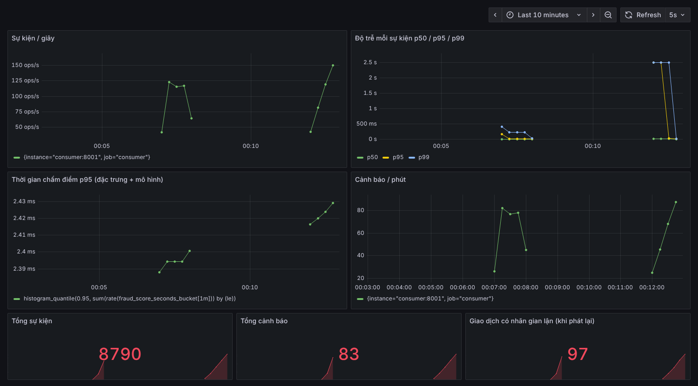

# realtime-fraud: chấm điểm gian lận từng giao dịch trên luồng

> Thư mục này là một phần của repo `risk-ml-platform` (xem [README gốc](../README.md)): dùng chung MLflow, Prometheus,
> Grafana và thư viện `riskops` với mô hình tín dụng trong `credit/`. Lệnh dưới đây chạy từ thư mục `fraud/`.
> Phần thêm khi gộp: đo drift trên luồng (PSI trên 2000 giao dịch gần nhất, `risk_feature_psi{model="fraud"}`),
> `python -m fraudrt.train --mlflow` đăng ký `fraud-lgbm` vào MLflow, `python -m fraudrt.promote` duyệt champion,
> consumer nạp `MODEL_URI=models:/fraud-lgbm@champion`.

Mỗi giao dịch đi vào topic Kafka được chấm điểm ngay (vài mili giây) bằng LightGBM, dùng cả đặc trưng của chính giao
dịch lẫn **đặc trưng cửa sổ thời gian** (tài khoản này đã gửi / nhận bao nhiêu lần, bao nhiêu tiền trong 1 giờ, 24 giờ
qua) lưu trong Redis. Điểm vượt ngưỡng thì gửi cảnh báo (log hoặc Telegram) và ghi vào topic `alerts`. Prometheus +
Grafana theo dõi tốc độ, độ trễ, số cảnh báo.

Dữ liệu: [PaySim](https://www.kaggle.com/datasets/ealaxi/paysim1) (6,3 triệu giao dịch tiền di động mô phỏng, có nhãn
gian lận, công khai trên Kaggle). Repo không chứa dữ liệu; `make data` tải về máy bạn.

```
 producer (phát lại PaySim theo thời gian)
     │  key = tài khoản gửi
     ▼
 Redpanda topic "transactions"  ──►  consumer ──► featurize(tx) ◄──► Redis (cửa sổ 1h / 24h mỗi tài khoản)
                                        │             │
                                        │             ▼
                                        │        LightGBM -> điểm
                                        ├──► topic "alerts" + Telegram (nếu điểm >= ngưỡng)
                                        └──► /metrics :8001 ──► Prometheus ──► Grafana :3000
```

## Kết quả trên PaySim

Điền sau khi chạy `make data train up bench` (lấy số từ `reports/train.md` và `reports/stream.md`). X là chưa đo.

| mô hình (tập test, 15% thời gian cuối) | PR-AUC | ROC-AUC | precision | recall | số cảnh báo |
|---|---|---|---|---|---|
| đoán ngẫu nhiên (= tỉ lệ gian lận) | X | 0.5 | | | |
| LightGBM, chỉ đặc trưng của giao dịch | X | X | X | X | X |
| LightGBM + đặc trưng cửa sổ | X | X | X | X | X |

| trên luồng (máy: X, `RATE=X`) | sự kiện/giây | p50 | p95 | p99 | lệch đặc trưng offline/online |
|---|---|---|---|---|---|
| consumer 1 tiến trình | X | X ms | X ms | X ms | X |

### Đã kiểm chứng trên dữ liệu GIẢ LẬP (không phải kết quả)

Cả chuỗi đã chạy thật trong Docker (Redpanda + Redis + consumer + Prometheus + Grafana) với dữ liệu giả lập cùng định
dạng PaySim (`make train-synthetic up bench-synthetic`). Các con số chỉ chứng minh đường ống chạy đúng; gian lận giả
lập dễ hơn thật nhiều.

- Huấn luyện ([docs/demo_train_synthetic.md](docs/demo_train_synthetic.md)): PR-AUC 0.924 có cửa sổ, 0.880 không
  cửa sổ, đoán ngẫu nhiên 0.013.
- Luồng ([docs/demo_stream_synthetic.md](docs/demo_stream_synthetic.md)): 7000 sự kiện, 305 sự kiện/giây, p50 6.9 ms,
  p95 8.7 ms, p99 218.9 ms. Lần chạy `bench-synthetic` khác (4000 sự kiện, gửi 400/giây): p50 6.2 ms, p95 95.2 ms,
  p99 331.8 ms.
- Kiểm tra lệch đặc trưng: 4000 / 4000 giao dịch, 19 đặc trưng, **không lệch** (sai khác lớn nhất cỡ 1e-11, do làm tròn
  số thực).



## Chạy

Cần Python 3.10+ và Docker (Compose v2). Test không cần Docker.

```bash
make install
make test                      # ~20 giây
make data                      # tải PaySim (cần ~/.kaggle/kaggle.json)
make train                     # -> models/, reports/train.md (vài phút trên CPU)
make up                        # Redpanda, Redis, consumer, Prometheus, Grafana
make produce                   # phát phần test vào topic; mở http://localhost:3000 (admin / admin)
make bench                     # đo độ trễ + kiểm tra lệch đặc trưng -> reports/stream.md
make down
```

Chưa tải được PaySim thì dùng `make train-synthetic`, `make up`, `make bench-synthetic`.

Cảnh báo Telegram: tạo bot với @BotFather, lấy chat id, rồi tạo file `.env` cạnh `docker-compose.yml`:

```
TELEGRAM_TOKEN=...
TELEGRAM_CHAT_ID=...
```

Không có `.env` thì cảnh báo chỉ ghi ra log của consumer (`docker compose logs -f consumer`). Mỗi phút gửi tối đa 20
tin để một đợt gian lận không làm ngập nhóm chat.

Không có máy cài Docker: [notebooks/fraud_colab.ipynb](notebooks/fraud_colab.ipynb) chạy trên Colab (CPU), huấn luyện
và phát lại luồng ngay trong notebook bằng kho cửa sổ trong bộ nhớ (cùng logic với Redis).

## Thiết kế

### Đặc trưng

| nhóm | đặc trưng |
|---|---|
| giao dịch | loại (one-hot 5 loại), số tiền, log số tiền, giờ trong ngày |
| số dư | tỉ lệ số tiền / số dư, tài khoản gửi bị rút hết, số dư người nhận ban đầu bằng 0, độ lệch số dư bên gửi và bên nhận (số dư trước ± số tiền khác số dư sau) |
| cửa sổ (Redis) | với tài khoản gửi và tài khoản nhận: số giao dịch 1 giờ qua, 24 giờ qua, tổng tiền 24 giờ qua |

Đặc trưng cửa sổ chỉ đếm các giao dịch **trước** giao dịch đang chấm (không tính chính nó, không nhìn tương lai). Bảng
ablation trong `reports/train.md` cho biết cửa sổ thêm được bao nhiêu PR-AUC.

PaySim chỉ có cột `step` (giờ thứ mấy). Mỗi giao dịch được gán thời điểm cố định `step*3600 + vị trí trong giờ` để phát
lại như luồng; huấn luyện và consumer thấy cùng thời điểm. Cột `isFlaggedFraud` (quy tắc của hệ cũ) bị bỏ.

### Không lệch giữa huấn luyện và phục vụ

Lỗi hay gặp nhất của hệ thời gian thực là đặc trưng lúc huấn luyện (tính bằng pandas trên cả bảng) khác đặc trưng lúc
chạy (tính từng sự kiện). Ở đây chỉ có **một** hàm `features.featurize(store, tx)`:

- huấn luyện: phát lại toàn bộ lịch sử theo thứ tự thời gian qua `MemoryWindows`;
- consumer: gọi đúng hàm đó với `RedisWindows`.

Hai kho cửa sổ có test so khớp với nhau, và `scripts/parity.py` (chạy trong `make bench`) so đặc trưng consumer đã dùng
với đặc trưng tính lại offline cho từng `tx_id`. Lệch quá 1e-6 thì script trả mã lỗi.

### Vì sao PR-AUC

Gian lận chiếm khoảng 0,1% giao dịch PaySim. Accuracy 99,9% đạt được bằng cách không bao giờ cảnh báo, ROC-AUC cũng
cao một cách dễ dãi vì có quá nhiều giao dịch sạch. PR-AUC đo trực tiếp đánh đổi "bắt được bao nhiêu gian lận" và "bao
nhiêu cảnh báo là đúng"; mốc so sánh là tỉ lệ gian lận trong tập test. Ngưỡng cảnh báo chọn trên tập valid (F1 lớn
nhất), precision / recall báo cáo trên tập test.

### Xử lý lỗi trên luồng

- Consumer commit offset **sau** khi chấm. Chết giữa chừng thì xử lý lại vài giao dịch; Redis không đếm trùng vì phần
  tử cửa sổ là `tx_id:amount` (ZADD lần hai không thêm gì).
- Độ trễ tính từ timestamp Kafka lúc producer gửi tới lúc chấm xong, nên gồm cả thời gian nằm trong hàng đợi.

## Giới hạn

- Topic có 1 partition để giữ đúng thứ tự thời gian của mọi tài khoản. Tăng partition (key = tài khoản gửi) thì cửa sổ
  bên gửi vẫn đúng, nhưng cửa sổ bên **nhận** có thể thấy giao dịch đến lệch thứ tự giữa các partition; khi đó cần
  watermark hoặc một bước gom theo tài khoản nhận (Flink / Kafka Streams).
- Thời điểm trong giờ là gán nhân tạo; PaySim cũng là dữ liệu mô phỏng, mô hình tốt trên PaySim chưa chắc tốt trên giao
  dịch thật.
- Độ trễ đo trên một máy, consumer một tiến trình; p99 bị kéo lên khi consumer vừa khởi động hoặc khi producer gửi
  nhanh hơn tốc độ xử lý (hàng đợi dài ra).
- Redis để không lưu xuống đĩa cho gọn demo; chạy thật cần bật AOF hoặc dựng lại cửa sổ từ topic.

## Cấu trúc

```
src/fraudrt/
  data.py        PaySim -> bảng chuẩn, gán thời điểm; bộ giả lập cùng định dạng
  features.py    featurize + MemoryWindows / RedisWindows (một nguồn đặc trưng duy nhất)
  train.py       chia theo thời gian, LightGBM, chọn ngưỡng, ablation -> models/, reports/train.md
  scorer.py      nạp mô hình, chấm một giao dịch
  alerts.py      cảnh báo log / Telegram (giới hạn số tin mỗi phút)
  producer.py    phát lại dữ liệu vào topic với tốc độ cố định
  consumer.py    đọc topic, chấm điểm, cảnh báo, drift trên cửa sổ trượt, /metrics cho Prometheus
  promote.py     so champion và challenger trong MLflow trên cùng tập test mới, đổi alias nếu tốt hơn
scripts/         tải dữ liệu, bench (độ trễ + lệch đặc trưng), parity.py
monitoring/      cấu hình Prometheus, dashboard Grafana (tự nạp khi bật)
```

Giấy phép mã nguồn: MIT. Dữ liệu PaySim theo điều khoản trên trang Kaggle của bộ dữ liệu.
